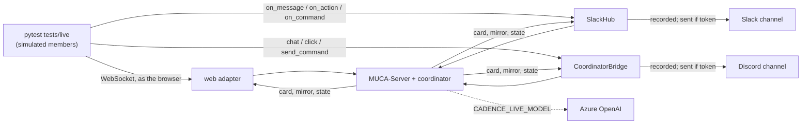

# Cross-channel end-to-end tests (live or offline)

35 scenarios that check that one Cadence project works the same on the web,
Discord and Slack: linking, identity, chat in sync, cards, the plan.
Code: `tests/live/` (`harness.py` first). One suite, three levels of "real".

## Run it

| Where | Command | What is real |
|---|---|---|
| Anywhere (CI too) | `cd prototype && python -m pytest tests/live` | All the code (MUCA-Server, coordinator, web adapter, Discord bridge, Slack hub); model and judge scripted; Discord and Slack recorded |
| With a model key | `CADENCE_LIVE_MODEL=1` + `AZURE_OPENAI_*` (or `OPENAI_API_KEY`) | + every word Cadence writes (cards, plan, ask, check-in) by the real model |
| Your PC, one step | double-click `run_live_tests.bat` (or `python run_live_tests.py`) | + Cadence's posts go to your real Slack and Discord channels |

`run_live_tests.py` reads the `.env` files the bots already use, picks the
channels by itself (Slack: the first channel the bot is in; Discord: the first
channel in `data/mulca.db`), turns the real model on, runs the suite and writes
`live-report.txt`. No token is typed or printed. Each line it posts carries a
short stamp, so it is easy to tell apart.

Variables, all optional: `CADENCE_MUCA_URL` (a MUCA-Server already running,
real Realtime agents and real judge), `CADENCE_TEST_SLACK_CHANNEL`,
`CADENCE_TEST_DISCORD_CHANNEL`, `CADENCE_LIVE_TIMEOUT` (seconds, default 10
scripted, 120 live).

### Last runs (27 Nov 2026)

| Mode | Result |
|---|---|
| Offline, 3 runs in a row | 37 passed, 1 skipped (P07 needs the real chat log) each time |
| Real Azure model for the coordinator (`gpt-6.1-sol`), from the cloud session | 37 passed, 1 skipped (C10 rewritten with a real discussion: one question alone is no task to delegate) |
| Real Slack and Discord channels | not run yet: needs the tokens, which live only on the PC and on Render |

## Scenarios

Linking and identity (`test_e2e_link_and_chat.py`)

| Id | Scenario |
|---|---|
| L01 | Pasting the space's invite link links Discord and Slack; both read the same project |
| L02 | A wrong invite link is explained, nothing is linked, nothing is copied |
| L03 | A bare word that looks like a code never links |
| L04 | Unlink: the channel has its own plan again and stops receiving copies |
| L05 | `/coordinator me` on Discord and Slack: one person, one name, own avatar on the web |
| L06 | Two different "Ada" get "Ada (Web)" and "Ada (Discord)" |
| L07 | A personal code works once |

Chat in sync

| Id | Scenario |
|---|---|
| L08 | Web chat shows on Discord and Slack |
| L09 | Discord chat shows on the web and Slack |
| L10 | Slack chat shows on the web and Discord |
| L11 | A line never comes back to where it was written |
| L12 | Slack shows `&`, `<`, `>` as written |
| L13 | Cadence's answer on Discord reaches the web and Slack |
| L14 | Three channels, one conversation, in order |

Cards (`test_e2e_cards_and_plan.py`)

| Id | Scenario |
|---|---|
| C01 | A card made on the web shows on Discord and Slack, same buttons |
| C02 | Confirmed on Discord: confirmed on Slack and the web, with who |
| C03 | Confirmed on Slack: confirmed on Discord and the web |
| C04 | Confirmed on the web: confirmed on Discord and Slack |
| C05 | Rejected anywhere: "Turned down by …" everywhere, nothing saved |
| C06 | The first valid click wins; a late click elsewhere is refused |
| C07 | Someone outside the group cannot answer a card |
| C08 | The demo video: a CS5 card from Discord chat, taken on Discord, confirmed on Slack, task on the web |
| C09 | A CS3 decision closed on Slack lands in the decision log |
| C10 | "Not now" on Discord silences the card everywhere |
| C11 | "Why?" on Slack shows the messages written on Discord |
| C12 | A Slack bot that restarted still gets the cards (warm-up) |
| C13 | Two Discord channels of one space both get the card |

The plan

| Id | Scenario |
|---|---|
| P01 | A task added on Discord is in the web plan |
| P02 | A dependency set on Slack is in the web plan |
| P03 | A status set on the web shows on Discord and Slack |
| P04 | Task numbers stay put when tasks are added |
| P05 | A plan asked on Slack is confirmed on the web |
| P06 | A check-in asked on Discord answers |
| P07 | Catch-up on Slack tells what was said on Discord (real chat log only) |
| P08 | The voice transcript answers even when nobody spoke |

Plus `test_harness_real_paths.py`: the real-channel paths of the harness and
the runner, with stand-ins (no network).

## Bugs these tests found (fixed)

- Harness: the web tab read its socket only while waiting, so later frames were
  never seen (test code only).
- Server: a ripe discussion on Slack or Discord never became a "close the
  decision" card when a member's group name carried a channel tag ("Ada
  (Slack)"): the card writer read the chat under the plain names and the
  members under the group's names, so "who argued" never matched. Fixed at
  the source: the chat lines a writer reads now use the group's names
  (`ProactiveBridge(name_of=...)`, wired in the router). Tests:
  `test_the_chat_a_writer_reads_names_people_as_the_group_does`,
  `test_cs3_counts_members_by_the_names_the_group_uses`.

## Architecture

### ADR-004: one e2e suite, real parts switched on by the environment

**Status.** Accepted, 27 Nov 2026.

**Context.** The demo depends on web, Discord and Slack staying in sync. Real
Slack and Discord tokens live only on the team's PC and on Render; the cloud
session that writes the code has the Azure key but no platform tokens.
Realtime WebSockets to Azure do not pass this session's proxy (404), chat
completions do.

**Decision.** One suite whose assertions never change. The environment decides
what is real: the model (`CADENCE_LIVE_MODEL`), a whole running server
(`CADENCE_MUCA_URL`), the Slack and Discord channels (tokens). Members are
simulated at the bot's entry points in every mode. `run_live_tests.bat` makes
the fullest run one double-click on the PC.

**Alternatives.**
- Black-box tests through the Slack and Discord apps: impossible by API. A
  bot cannot write as a person on Discord, nor press a Slack button, nor run a
  slash command.
- A Discord self-bot or a Slack user token: against Discord's terms, and a
  second set of secrets to handle.
- Tests against the Render deployment: they would need a test-only control
  endpoint on a public service.

**Consequences.** It runs everywhere, including CI, and each level adds realism
without new code. It does not exercise Slack Socket Mode or the Discord gateway
themselves (thin layers, covered by `test_slack.py` and the manual check in
TRYING_ON_DISCORD.md). Proactive scenarios (C08-C11) use the scripted judge,
so they are skipped when `CADENCE_MUCA_URL` points to a full server: there,
whether a card comes is the real judge's call, checked by hand with DEMO_SCRIPT.md.

**Trade-offs.** Speed and repeatability first; full platform fidelity only on
the PC run.
